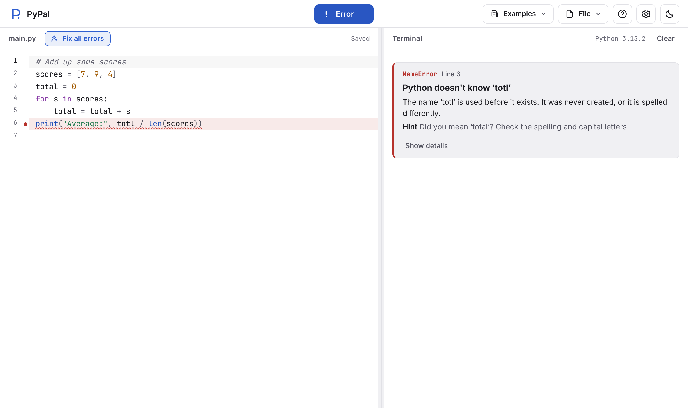
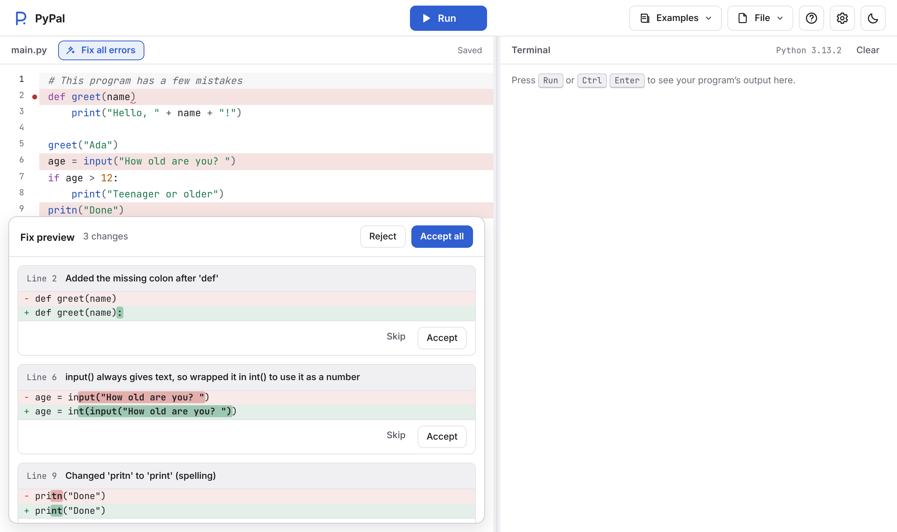
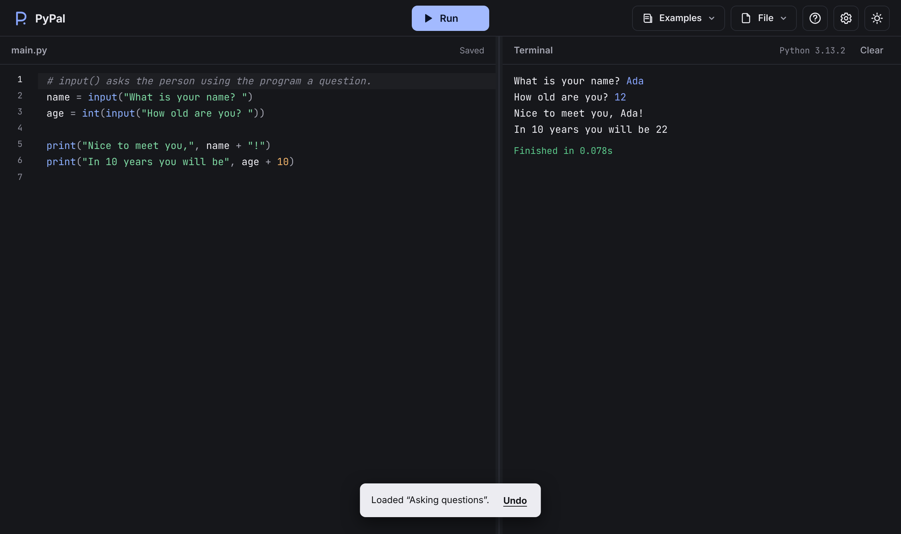
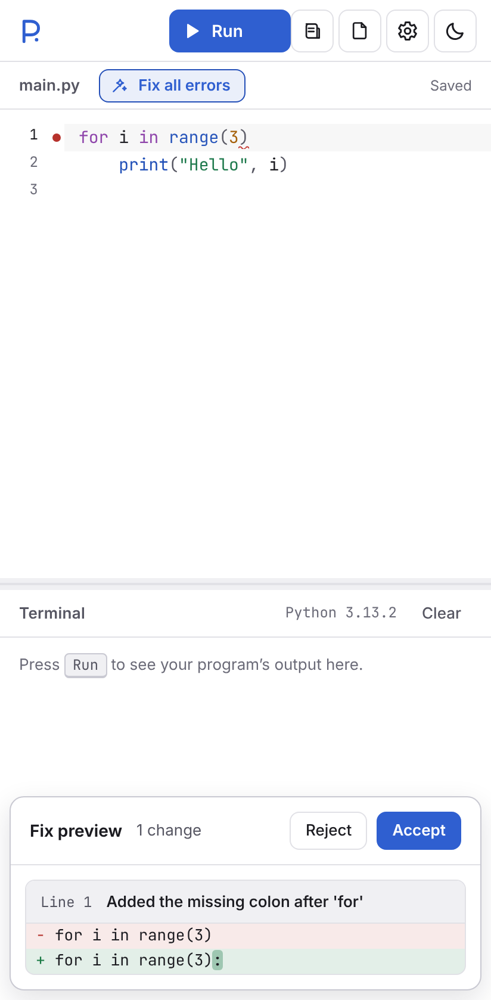

# PyPal

**Your Python pal.** A free Python editor that runs entirely in your browser. Real Python (Pyodide), no sign-in, no backend, no ads.

Live: https://coder-4847.github.io/PyPal/

| Friendly errors | One-click fixes, each with a reason |
| --- | --- |
|  |  |
| **Real Python, with input()** | **On a phone** |
|  |  |

**Features so far**

- Editor, real Python in a Web Worker, Run/Stop, inline `input()`, automatic package loading, resizable layout, light/dark theme, autosave.
- **Friendly errors:** every traceback becomes a card (what happened, where, a hint). Click it to jump to the line; the raw traceback is behind *Show details*.
- **Live syntax check:** problems are underlined as you type; hover for a plain-English message.
- **One-click fixes:** *Fix all errors* (or select lines and use *Fix errors in these lines*). Every change in the diff preview has a one-line reason; accept all, accept one, or reject, and Undo works afterwards.
- **Honest by design:** a fix is only offered if Python verifies it. Otherwise PyPal says what looks wrong and where.
- **Starters, sharing, files:** six tiny examples (one deliberately broken, to try Fix on), a share link (your code is compressed into the URL hash, no server), download and open `.py` files (also by drag and drop).
- **Command palette** (Ctrl/Cmd+K), a shortcut sheet (`?`), menus, light/dark theme.
- **Works offline** after the first visit (the app, Python and any package you have used are cached) and can be installed as an app.
- **Accessible:** full keyboard use (Escape then Tab leaves the editor), screen-reader announcements for results, errors and fixes, AA contrast in both themes, reduced-motion support.
- **Optional AI help:** add your own key in Settings. It is stored only in your browser and sent only to the provider; there is no shared key and no PyPal server.

## Develop

```bash
npm ci
npm run dev        # http://localhost:5173 (dev server sets the isolation headers)
npm test           # Vitest
npm run build      # type-check + production build into dist/
npm run test:e2e   # Playwright (builds and serves dist/ like GitHub Pages does)
```

`npm run prepare:pyodide` (run automatically before `dev` and `build`) copies the pinned Pyodide core into `public/pyodide`.

## How it works

- **Editor:** CodeMirror 6 with Python highlighting, auto-indent, bracket matching and light autocomplete.
- **Python:** Pyodide 0.29.5 in a module Web Worker. Output streams to the terminal; `input()` blocks the worker on a `SharedArrayBuffer` until you answer inline.
- **Stop:** sets Pyodide's interrupt buffer. If Python does not react within 1.5 s (or the page is not cross-origin isolated) the worker is restarted.
- **Isolation on GitHub Pages:** Pages cannot send COOP/COEP headers, so `public/sw.js` adds them (the page reloads once on the first visit).
- **Packages:** `import numpy` (and other Pyodide packages) loads automatically from the matching jsDelivr release.

## Tests and checks

```bash
npm test            # Vitest: fix engine + 96-case fixture corpus (boots Pyodide in Node), share links, examples, explanations
npm run test:e2e    # Playwright: features, offline, axe accessibility audits in both themes, motion
E2E_URL=https://<user>.github.io/<repo>/ npm run test:e2e   # the same suite against a live site
npm run build       # type-check, build, and enforce the bundle budget (scripts/check-budget.mjs)
```

The e2e suite has four projects: `chromium`, `firefox`, `webkit` and `phone` (Pixel 7). Pick one with `--project=webkit`. If HTTPS goes through an intercepting proxy, point `PW_FIREFOX_PROFILE` at a Firefox profile whose NSS store trusts its CA (Chromium and WebKit use the system store).

`?motion=slow` slows every animation 5x so it can be reviewed frame by frame. `node scripts/motion-audit.mjs` records frame times for each animated moment; `node scripts/screenshots.mjs` regenerates the README screenshots.

## Security

- No backend and no accounts. Code, settings and the optional AI key live in your browser's localStorage.
- Content-Security-Policy: scripts only from the site (plus WebAssembly for Python); network only to the site, the Pyodide CDN and the two optional AI providers; no framing. Sent as a header by the service worker (covering the Python workers) and as a meta tag on the first visit.
- Everything shown on screen (program output, error messages, shared links, file names, AI notes) is inserted as text, never as HTML.
- The AI key is sent only to the provider you chose, only when you ask for an AI fix, and is never logged or cached.

## The fix engine

Fixes run in tiers and stop at the first verified result:

1. **Local rules** (`src/fix/rules.ts`): missing colons, brackets, quotes and commas, indentation, `=` vs `==`, misspelled keywords and names, wrong case, Python 2 `print`, `input()` used as a number, text plus number, and more. They only propose small edits.
2. **Verification** (`src/fix/engine.ts`): each candidate is checked with `ast.parse` and `compile`; runtime fixes are re-run in a sandbox worker with a stubbed `input()` and a step limit. Up to 8 passes, because one fix often reveals the next.
3. **AI (optional)**: if the rules cannot produce a verified fix and a key is set, the model's answer goes through the same verification.

Tests live in `tests/` and `fixtures/broken/` (`name.broken.py` + `name.fixed.py`, or `name.keep.py` for code that must be left alone). The Vitest runner boots Pyodide in Node, so the same `src/py/diagnose.py` is used in tests and in the browser.

## Deploy

Push to `main`. `.github/workflows/deploy.yml` installs, tests, builds and publishes to GitHub Pages (set **Settings → Pages → Source** to *GitHub Actions* once).

See `PROGRESS.md` for status and `DECISIONS.md` for design decisions. Fonts: Inter and JetBrains Mono, SIL Open Font License.
